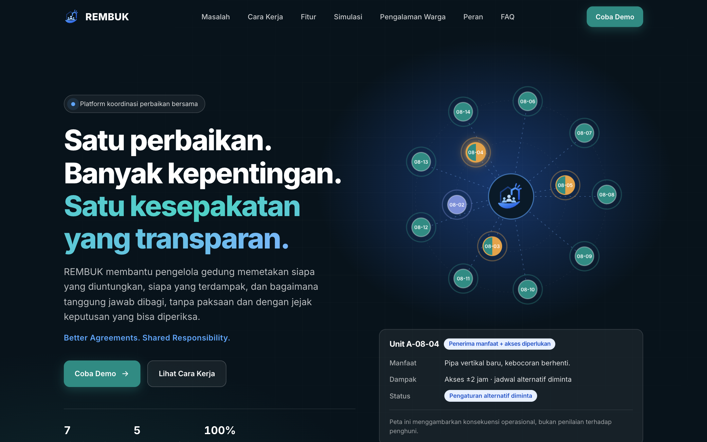
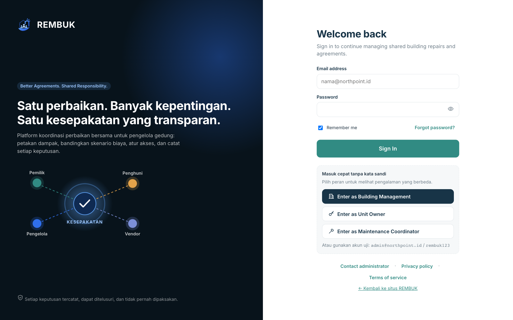
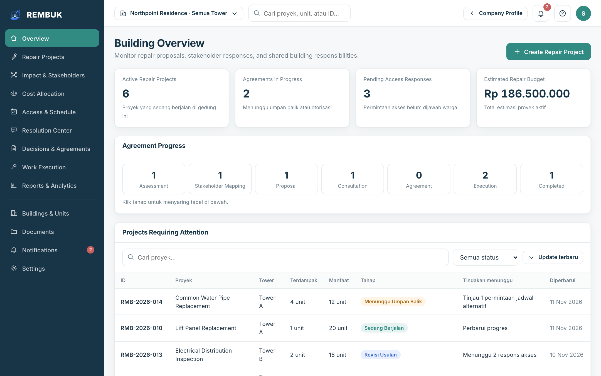
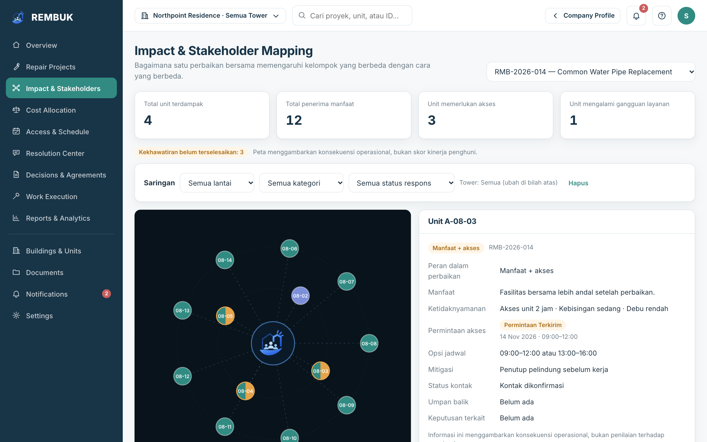
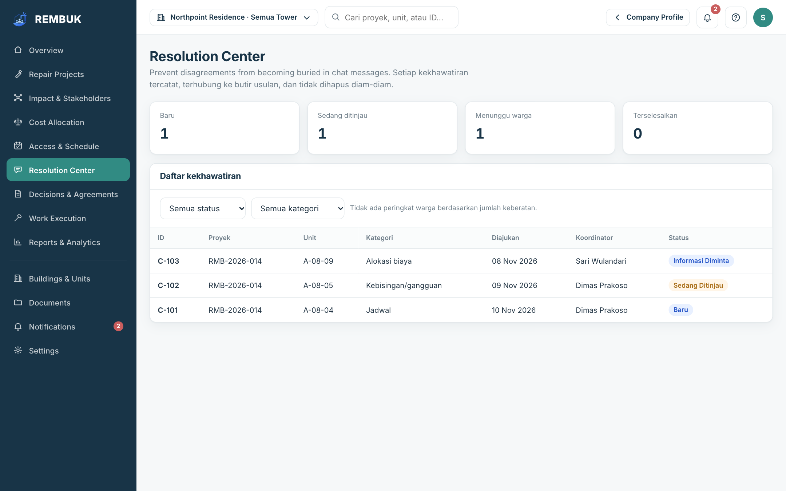

<div align="center">

# REMBUK

### Satu perbaikan. Banyak kepentingan. Satu kesepakatan yang transparan.

<p>Platform koordinasi perbaikan bersama untuk pengelola gedung: petakan dampak, bandingkan skenario biaya, atur akses, dan catat setiap keputusan.</p>

<p>   </p>

<p><i>Better Agreements. Shared Responsibility.</i></p>
</div>

Satu pipa bocor di gedung bersama melibatkan pemilik, penghuni, pengelola, dan vendor, masing-masing dengan kepentingan berbeda. REMBUK menjaga prosesnya tetap terlihat: siapa terdampak, siapa menanggung berapa, kapan akses dibutuhkan, dan apa yang akhirnya disepakati. Tidak ada keputusan yang dipaksakan; REMBUK mendukung keputusan pihak berwenang, bukan menggantikannya. Semua data contoh fiktif (Northpoint Residence).

## Tampilan

| | |
| --- | --- |
| **Profil perusahaan** (`/`): masalah, cara kerja, fitur, dan simulasi.<br> | **Masuk cepat** (`/app/`): pilih peran tanpa kata sandi untuk mencoba demo.<br> |
| **Ikhtisar gedung**: proyek aktif, progres kesepakatan, dan tindakan yang menunggu.<br> | **Peta dampak**: siapa mendapat manfaat dan siapa terganggu, per unit.<br> |
| **Pusat resolusi**: setiap kekhawatiran tercatat dan tidak hilang di obrolan.<br> | |

## Masalah

Satu pipa bocor di gedung bersama melibatkan empat pihak dengan kepentingan berbeda: **pemilik**, **penghuni**, **pengelola**, dan **vendor**. Informasi tercecer di grup chat, biaya diperdebatkan tanpa dasar yang jelas, dan jadwal akses ke unit bertabrakan. REMBUK tidak memutuskan apa pun. Ia membuat prosesnya terlihat dan dapat ditelusuri.

## Alur

1. Pengelola membuat proyek, memetakan unit terlibat (penerima manfaat, penyedia akses, terganggu), dan menyusun skenario biaya.
2. Usulan diterbitkan. Pemilik melihat **usulan kontribusi** unitnya (bukan kewajiban) beserta alasannya; penghuni tidak melihat nominal.
3. Warga merespons akses dan jadwal, atau mengajukan kekhawatiran. Semuanya tercatat di Pusat Resolusi dan tidak hilang di obrolan.
4. Pihak berwenang memutuskan di luar REMBUK. Keputusan dicatat beserta dasarnya.
5. Vendor melihat jadwal per kode unit dan mencatat progres langkahnya. Pengelola menutup proyek.
6. Setiap kejadian masuk log yang hanya bertambah; ringkasan kasus dapat diekspor ke PDF dan teks WhatsApp.

## Fitur

- Proyek perbaikan bertahap, peta dampak per unit, alokasi biaya dengan skenario A/B/C, akses dan jadwal, Pusat Resolusi, keputusan dan kesepakatan, pelaksanaan, laporan.
- **Empat peran**: pengelola (juga koordinator), pemilik, penghuni, vendor, dengan tampilan dan hak berbeda.
- **Log kejadian append-only** dengan rantai hash. Perubahan diam-diam terdeteksi (di server: pemicu basis data memblokir UPDATE/DELETE).
- **Ekspor**: PDF ringkasan kasus (dibuat di peramban) dan teks siap bagikan ke WhatsApp. REMBUK tidak mengirim pesan; pengguna yang menyalin atau membuka WhatsApp dan menekan kirim.
- **Pengingat tenggat**: daftar di aplikasi dan notifikasi peramban lokal, **mati secara bawaan** dan hanya aktif atas izin pengguna. Tidak ada pesan otomatis ke pihak lain.
- **PWA**: dapat dipasang dan jalan offline (cangkang aplikasi dan data demo lokal).
- Tampilan 360 px, uji aksesibilitas otomatis (axe), pemilih bahasa id/en (id bawaan).

## Arsitektur

```
packages/core/       logika bisnis TypeScript murni (tanpa DOM): biaya, pihak terdampak, tenggat,
                     rantai hash, ekspor teks/PDF, izin, i18n, adaptor Supabase. Diuji dengan Vitest.
packages/client/     titik masuk bundel supabase-js (hanya dimuat pada mode Supabase)
public/app/          UI vanilla JS (tetap seperti semula) yang memakai RembukCore hasil build
public/index.html    profil perusahaan
supabase/migrations/ skema Postgres + RLS + log append-only
supabase/tests/      tes RLS di PGlite (Postgres WASM)
e2e/                 Playwright: smoke tiap peran, privasi, ekspor, PWA offline, a11y, 360 px
scripts/build.mjs    bundel core, tulis config.js dan service worker
```

**Mengapa UI tidak ditulis ulang ke Next.js.** Aplikasi sepenuhnya sisi klien dan interaktif, tidak butuh SSR/SEO, dan menulis ulang ~200 KB UI membawa risiko menghilangkan fitur. Yang dipindah adalah logika bisnis ke paket yang diuji, sehingga kerangka UI dapat diganti kelak tanpa menulis ulang aturan.

## Model data

Tabel utama: `buildings`, `units`, `profiles`, `memberships` (pengguna x gedung x peran), `vendors`, `projects`, `project_units`, `cost_lines`, `scenarios`, `scenario_revisions`, `concerns`, `concern_messages`, `decisions`, `documents`, `work_steps`, `event_log`, `reminder_prefs`. Tabel `scenario_revisions`, `concern_messages`, `decisions`, `event_log` bersifat append-only. Peran dibaca dari `memberships`, bukan dari klaim JWT. Rincian: [docs/IMPROVEMENT-PLAN.md](docs/IMPROVEMENT-PLAN.md).

## Privasi: data apa disimpan, siapa melihat

| Data | Pengelola | Pemilik | Penghuni | Vendor |
| --- | --- | --- | --- | --- |
| Proyek (bukan Draf) | semua di gedungnya | yang melibatkan unitnya | yang melibatkan unitnya | yang ditugaskan |
| Rincian biaya | ya | ya | tidak | ya |
| Skenario dan usulan kontribusi | semua | yang diterbitkan | yang diterbitkan (tanpa nominal di UI) | tidak |
| Status akses unit | semua | unitnya | unitnya | jadwal per **kode unit** yang sudah diterima, tanpa identitas |
| Kekhawatiran dan utas | semua | miliknya | miliknya | tidak |
| Keputusan | semua | miliknya dan tingkat proyek | miliknya dan tingkat proyek | tidak |
| Dokumen | semua | berlabel "all" | berlabel "all" | "all" dan "vendor" |
| Log kejadian | semua | yang bertanda "parties" dan miliknya | idem | "parties" proyeknya |

Yang disimpan: nama tampilan, peran dan unit, isi proyek, respons, dan log. Tidak ada pelacak pihak ketiga. Di mode demo semua data ada di peramban Anda (localStorage) dan tidak dikirim ke mana pun. Penegakan sebenarnya ada di RLS (diuji); pada mode demo pembatasan peran hanya di tampilan.

## Menjalankan lokal (mode demo)

Prasyarat: Node.js 20+.

```sh
npm ci
npm run dev        # build core lalu server statis di http://localhost:3000 (/app/ untuk aplikasi)
```

Mode demo berjalan penuh tanpa akun, dengan data fiktif Northpoint Residence. Masuk cepat tersedia untuk lima peran (Pengelola, Pemilik, Penghuni, Koordinator, Vendor); akun uji `admin@northpoint.id` / `rembuk123`. Menu akun menyediakan **Reset data contoh**. Tanggal demo dikunci ke 11 Nov 2026 agar data contoh tidak basi; mode Supabase memakai jam nyata.

## Mode Supabase

Tanpa kredensial asli di repo. Langkah:

1. Buat proyek Supabase milik Anda; jalankan `supabase/migrations/*.sql` (atau `supabase db push`). Opsional `supabase/seed.sql` untuk data fiktif.
2. Buat pengguna lewat Supabase Auth, lalu tautkan peran: `insert into memberships (building_id, user_id, role, unit_id|vendor_id) ...`.
3. Salin `.env.example` ke lingkungan build Anda dan isi `REMBUK_SUPABASE_URL` dan `REMBUK_SUPABASE_ANON_KEY` (kunci anon yang publik; jangan pernah service role). Jalankan `npm run build`.

**Status jujur:** skema dan RLS diuji pada Postgres sungguhan (PGlite). Pemetaan data dan alur masuk diuji dengan klien palsu. Mode ini adalah **pratinjau baca-saja** (data dimuat sesuai peran; perubahan di layar belum ditulis ke server) dan **belum diuji terhadap instance Supabase nyata**. Penulisan memakai fungsi basis data yang sudah diuji (`respond_access`, dst.) dan perlu disambungkan ke tiap aksi UI.

## Pengujian

```sh
npm run lint && npm run typecheck && npm test && npm run build && npm run test:e2e
```

`npm test` menjalankan tes unit core dan 30 tes RLS. `test:e2e` memakai Chromium Playwright (desktop dan 360 px). CI (`.github/workflows/ci.yml`) menjalankan semuanya.

## Deploy ke Vercel

Impor repo di Vercel; `vercel.json` sudah mengatur `npm run build` dan `public/` sebagai output. Isi variabel lingkungan Supabase hanya bila memakai mode Supabase.

## Batasan

- Prototipe. Mode demo menyimpan data di peramban dan pembatasan peran hanya tampilan.
- Mode Supabase belum diuji ke server nyata dan baca-saja di UI (lihat atas).
- Dokumen yang diunggah pada demo tidak memiliki isi nyata (tidak ada penyimpanan berkas).
- i18n baru mencakup navigasi dan layar masuk; string lain masih tertanam (id).
- Rantai hash di peramban mendeteksi perubahan diam-diam, bukan penulisan ulang seluruh rantai.
- Diuji di Chromium; browser lain belum diuji menyeluruh.
- Dev dependency `typescript-eslint` membawa advisori minimatch tingkat sedang (hanya alat lint).

## Penafian

Semua data contoh **fiktif** (Northpoint Residence). REMBUK **bukan nasihat hukum** dan tidak menetapkan kewajiban pembayaran: "Usulan Kontribusi" hanyalah usulan, dan keputusan ada pada pihak berwenang dan para pemangku kepentingan. REMBUK mendukung keputusan manusia, bukan menggantikannya.

## Author & License

Created by Vassel Goleyu. Copyright (c) 2026 Vassel Goleyu. All rights reserved.
